<p align="center">
  
</p>

<h1 align="center">Ochi</h1>

<p align="center">
  <strong>A self-hosted AI workspace, across Web, iOS, and Android.</strong><br>
  Research, write, run code, and work with a computer. Keep the work in one place.
</p>

<p align="center">
  English · <a href="README.zh-CN.md">简体中文</a><br>
  <a href="#get-started">Get started</a> ·
  <a href="#how-ochi-works">How it works</a> ·
  <a href="docs/deployment.md">Self-hosting</a> ·
  <a href="docs/architecture.md">Architecture</a>
</p>

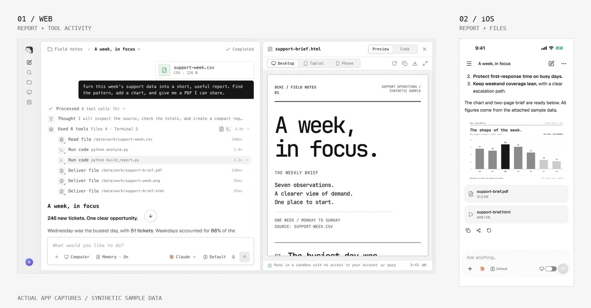

Ochi brings model choice, tools, files, memory, and a persistent Linux desktop
into a conversation. Connect your own providers, open the same workspace from a
browser or a native app, and follow a task from the first question to its
deliverables.

## From a question to something useful

Give Ochi a dataset and ask for a report. Follow the work as it checks the
source, runs the analysis, and prepares files. Open the chart, inspect the HTML
report beside the conversation, or read the PDF on your phone.

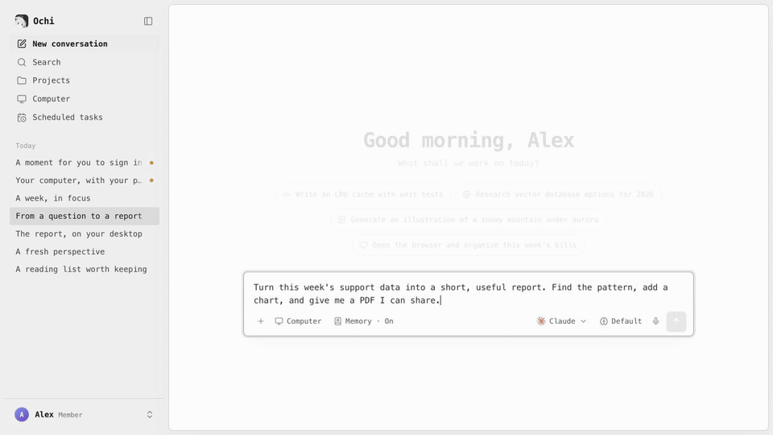

<details>
<summary>See the compact process view</summary>

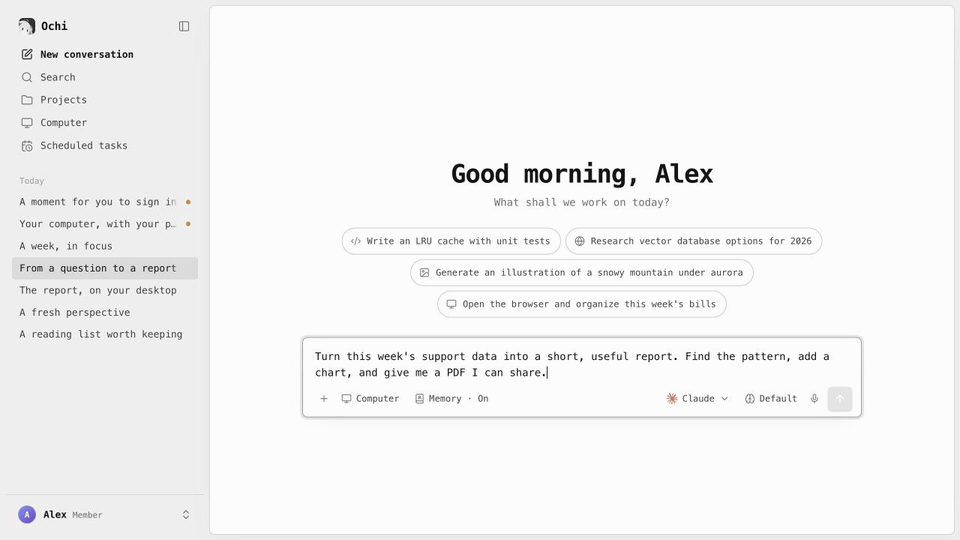

</details>

## Built for the whole task

| Capability | What you can do |
| --- | --- |
| **Models, on your terms** | Connect providers, select models and supported thinking levels, and retain your preferred model across new conversations. Administrators control availability, order, and defaults. |
| **Research and execution** | Search the Web, read sources, run commands, work with files, and inspect an ordered record of reasoning, progress, and tool results. Configure an external search provider when needed. |
| **Cloud execution** | The agent, tools, and working environment run on your server. Tasks continue after you close the app or browser; users need no local development setup or always-on personal computer. |
| **Files and deliverables** | Drop files into the Web composer or paste an image. Preview images, PDFs, and HTML; generate images with supported models; explicitly publish useful output as downloadable files. Transfers default to a configurable 1 GiB per file, independently of model input limits. |
| **Projects and scheduled tasks** | Keep related conversations under shared project instructions, or schedule work for later. |
| **Memory, with a clear boundary** | Keep useful preferences and facts across conversations, or start a conversation with memory off. Its choice is fixed for the whole conversation; saved chats and Computer behavior stay intact. |
| **Skills and MCP, as plugins** | Administrators bundle instructions and integrations into plugins. Users enable optional plugins; required defaults stay enabled. Capability discovery and execution enforce the same policy and Computer permission. |
| **A real Linux computer** | Open a persistent desktop, use its browser and applications, watch the agent work, and take over manually. Ordinary computation has its own environment; shared desktop access is scheduled explicitly. |
| **Your installation** | Manage providers, users, workspaces, diagnostics, application updates, and mobile download links from the administrator UI. Web, iOS, and Android support English, Simplified Chinese, and Traditional Chinese. |

## Web, iOS, and Android

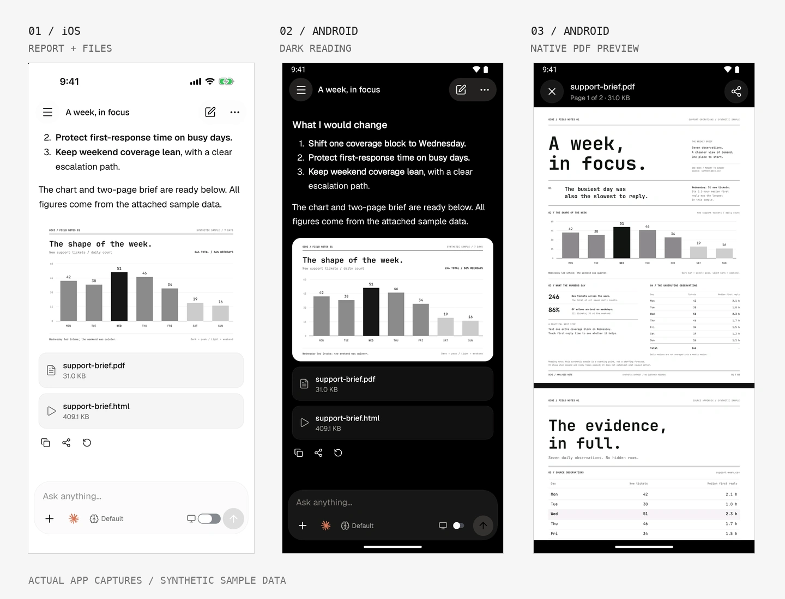

The iOS and Android apps use React Native for the conversation, composer,
Markdown, math, and native file previews. Both connect to the same backend as the
Web client, with synchronized history and live run state. Computer, isolated HTML,
and administration use dedicated Web surfaces where appropriate.

<details>
<summary>Watch the iOS image preview</summary>

Open an image from the conversation, then drag it down to return.

<p align="center">
  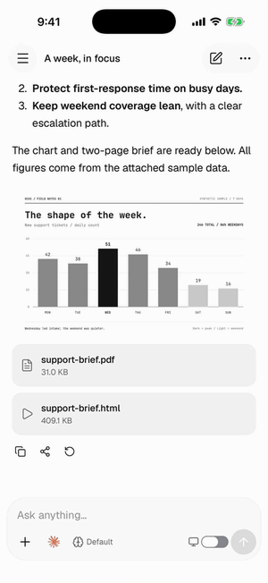
</p>

</details>

Choose a light or dark appearance, keep a draft while changing models, and move
between the conversation and its output. Native clients can connect to your own
HTTP or HTTPS backend. Administrators can publish an Android APK for in-app update
discovery and download; installation uses Android's system installer. The iOS
download entry opens a configured TestFlight or App Store link.

## An inspectable tool chain

Open a process group to inspect its commands, inputs, outputs, and file delivery
steps. Related calls stay grouped, with the details available a level deeper.
The final answer and its deliverables remain easy to read.

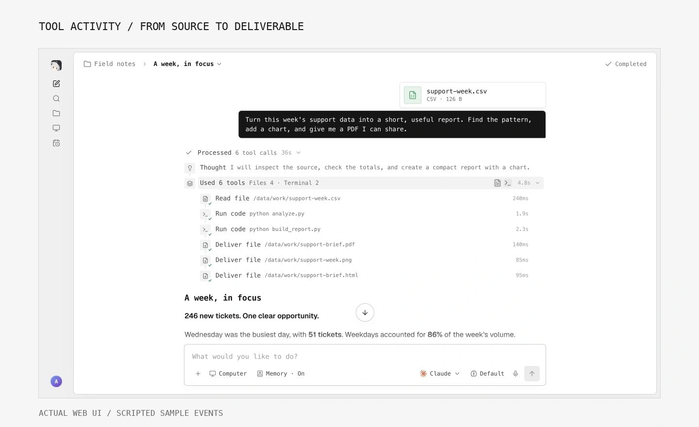

<details>
<summary>Watch the tool chain unfold</summary>

Expand the process, inspect two command results, then open the HTML report.

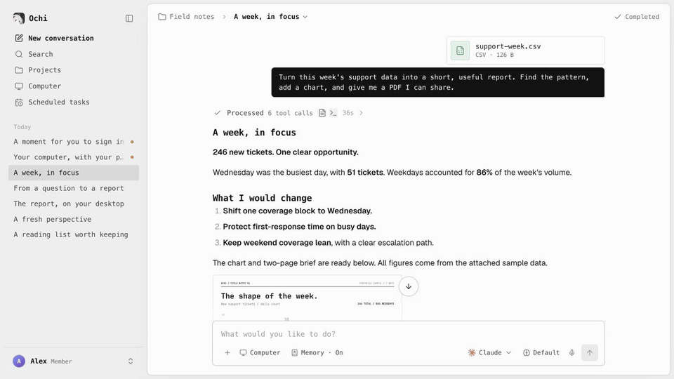

</details>

## How Ochi works

Ochi keeps execution, context, memory, and resource scheduling explicit. The
diagrams below describe the current implementation; the
[architecture document](docs/architecture.md) covers the contracts in detail.

### A server-owned execution loop

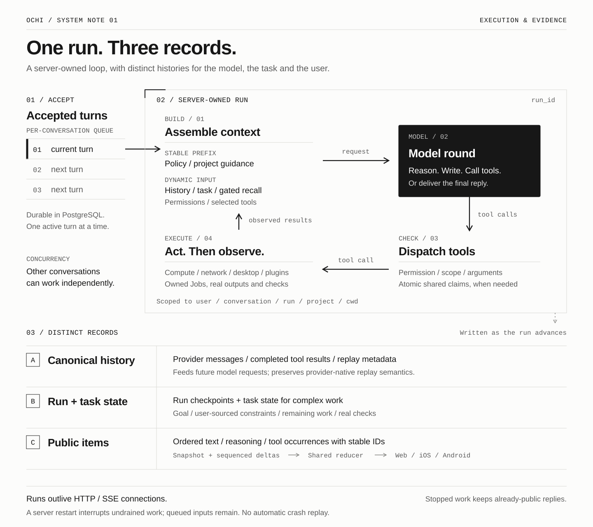

- **A conversation owns its input queue.** Accepted turns are persisted and run
  in order. Different conversations can work concurrently.
- **The next model round receives observed results.** Tool outcomes, unfinished
  work, and verification evidence feed task continuity. Commands have owned
  Jobs with real process state and logs.
- **What the model receives and what the user sees have distinct records.**
  Canonical provider/tool history supports future requests. Ordered public
  items preserve text, reasoning, and tool activity; snapshots and sequenced
  deltas drive a shared Web/native reducer. Stopping a run keeps already-visible
  replies visible.

A run lives on the server, independently of its page or stream connection.

### Context assembled for the task

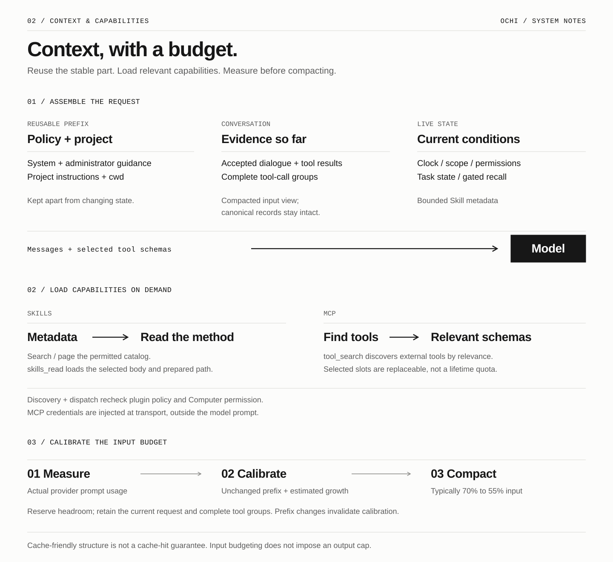

- **Stable instructions come first.** The prompt separates reusable policy and
  tool definitions from changing task state, environment, permissions, and
  relevant recall. This gives providers a reusable prefix where their caching
  supports it.
- **Capabilities are discovered before their details are loaded.** The agent can
  find a Skill or MCP tool, then load selected instructions or schemas. The
  private control runtime supplies MCP credentials at the transport boundary.
- **Usage calibrates the context budget.** Provider prompt usage calibrates the
  prefix already observed by the provider; newly appended content is still
  estimated. Compaction summarizes older evidence while preserving the canonical
  transcript; task constraints and outstanding work have their own state.

### Useful memory, scoped to its source

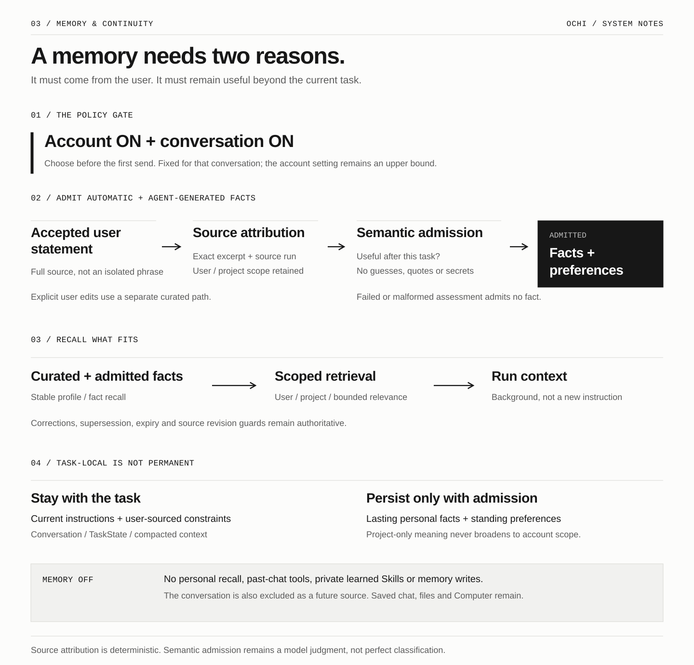

- **Task directions stay with the task.** A one-off request such as "in English"
  is assessed separately from a lasting language preference.
- **Automatic and agent-generated memory has an admission step.** Source
  attribution and semantic assessment decide whether a candidate is useful
  beyond the current task. Records retain scope and provenance for correction
  and supersession.
- **Memory off closes both directions.** Choose it before the first message:
  the conversation receives no personal recall or past-chat retrieval, and
  cannot become a source for future memories or learned Skills. Ordinary saved
  chat history remains available to its owner.

Memory off keeps saved conversations, Computer behavior, and administrator plugin
policies intact. Users can view and manage their saved memories.

### Independent compute. Coordinated desktop.

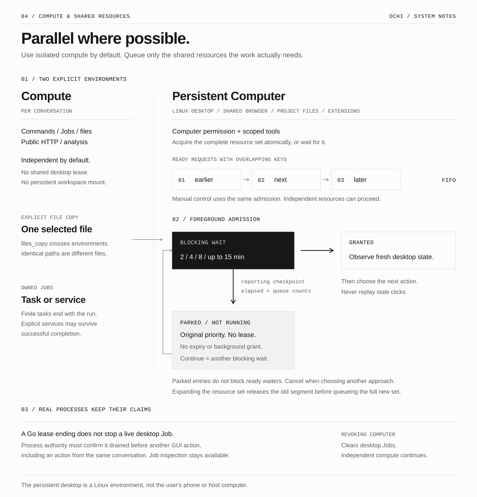

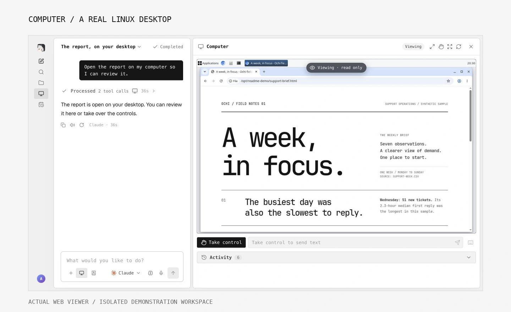

The agent can request Computer access for one turn or the conversation. When a
task needs you to sign in, it can pause and ask you to take control. Complete the
sign-in on the desktop, hand control back, and confirm that it can continue.

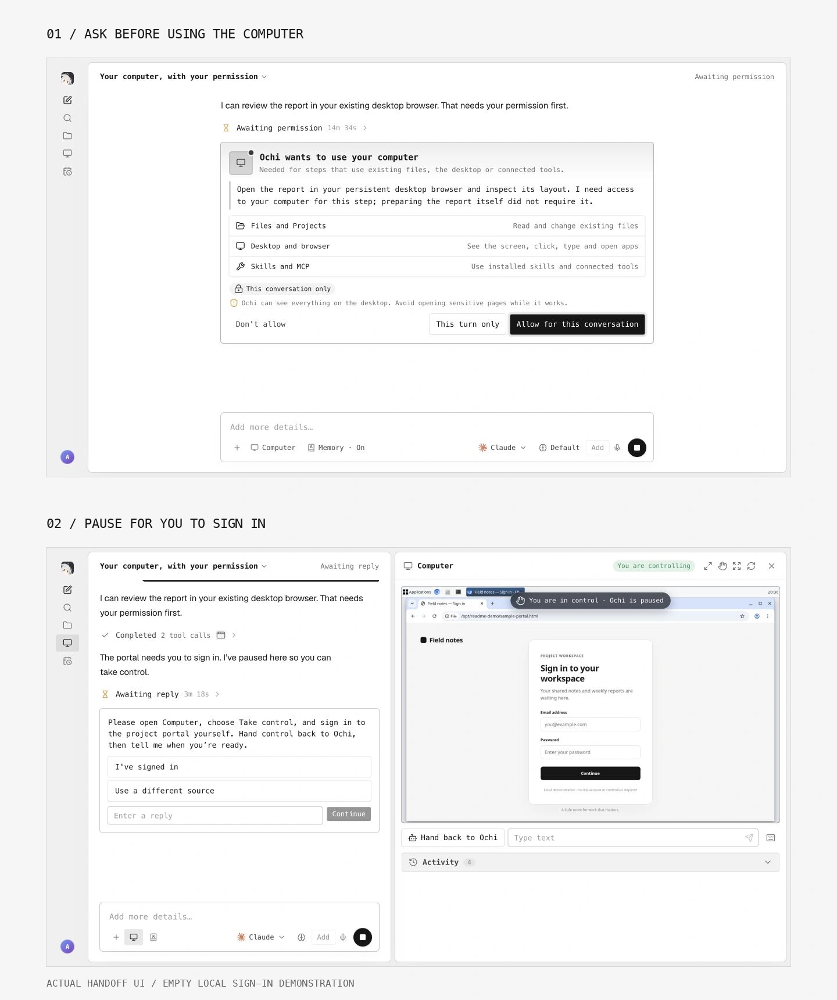

- **Ordinary commands use isolated compute.** Each conversation can run code
  without taking the shared desktop. Persistent desktop files require explicit
  scope; selected files can be copied between environments.
- **Conflicting shared work enters a ready FIFO queue.** Desktop and project
  resources are claimed together. Expanding the resource set releases the old
  segment before waiting for the new set, avoiding partial ownership.
- **Waiting is a foreground tool call.** Checkpoints report elapsed time and
  queue state. A parked request keeps its priority, holds no lease, and does not
  block ready work. Continuing starts another blocking wait; the system does
  not grant it in the background or replay a stale desktop action.
- **Real Jobs determine occupancy.** A live desktop process retains its claims
  until it drains. Desktop admission provides a fresh observation before the
  agent chooses its next GUI action.

The computer runs in Linux containers on the server.

## Get started

Requirements: Docker Engine with Compose. Docker Desktop and OrbStack can
provide the engine on macOS.

```sh
cp .env.example .env
```

Set `POSTGRES_PASSWORD` and the initial administrator's password in `OCHI_USERS`.
You can configure a model provider in `.env` or in the administrator UI after
login.

```sh
docker compose build
docker compose up -d db server
```

Open [localhost:8090](http://127.0.0.1:8090). The default port binding is
loopback-only. Provider keys stay on the server. `RUNNER=demo` explicitly enables
a development runner; missing provider configuration does not silently select
it.

For a published installation, use the matching image references from a CI build
and follow the [deployment guide](docs/deployment.md). The runtime is PostgreSQL
with pgvector, one Go service with the Web client embedded, and Docker-managed
compute/desktop environments.

## Explore the project

| Path | Responsibility |
| --- | --- |
| [`server/`](server/) | Go API, agent execution, storage, and embedded production Web app |
| [`web/`](web/) | React, TypeScript, and Vite Web client |
| [`mobile/`](mobile/) | Expo/React Native clients and versioned native projects |
| [`shared/`](shared/) | Conversation contracts, projections, and client state machinery |
| [`workspace/`](workspace/) | Linux tool bridge, plugin control, browser, and XFCE desktop |
| [`db/`](db/) | PostgreSQL image with pgvector |
| [`docs/`](docs/) | Current architecture, design, development, and operations |

- [Architecture](docs/architecture.md) — execution ownership, context, memory,
  plugins, and resource boundaries.
- [Design](docs/design.md) — rendering, visual language, and platform interactions.
- [Development](docs/development.md) — setup, verification, and repository conventions.
- [Deployment](docs/deployment.md) — configuration, persistence, and updates.
- [Releasing](docs/releasing.md) — iOS/Android packaging and signing.
- [AGENTS.md](AGENTS.md) — entry point for coding agents.

GitHub Actions builds multi-platform images and the combined Web/server binary.
An administrator explicitly requests application updates inside Ochi; a code
push does not deploy an installation. The rolling `edge` prerelease provides an
update channel without requiring a product version bump for every change.
