<p align="center">
  
</p>

<h1 align="center">Ochi</h1>

<p align="center">
  <strong>可自部署的 AI 工作空间，覆盖 Web、iOS 和 Android。</strong><br>
  研究、写作、运行代码、操作电脑，让问题到成果的整个过程留在同一处。
</p>

<p align="center">
  <a href="README.md">English</a> · 简体中文<br>
  <a href="#开始使用">开始使用</a> ·
  <a href="#ochi-如何工作">工作机制</a> ·
  <a href="docs/deployment.md">自部署</a> ·
  <a href="docs/architecture.md">架构文档</a>
</p>

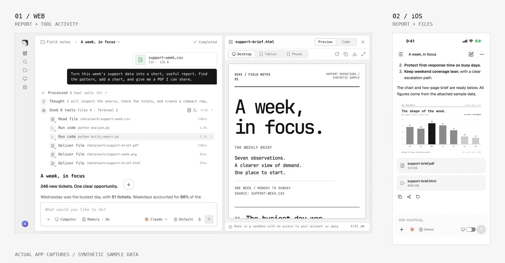

Ochi 把模型、工具、文件、记忆和持久化 Linux 桌面带进对话。接入自己的模型
服务，通过浏览器或原生客户端访问同一个后端，持续跟进一项任务，直到拿到可用
的成果。

## 从一个问题，到一份可用的成果

提供一份数据，让 Ochi 整理成报告。查看它如何读取来源、运行分析、准备文件；
在对话旁打开 HTML 报告，放大图表，或直接在手机上阅读 PDF。

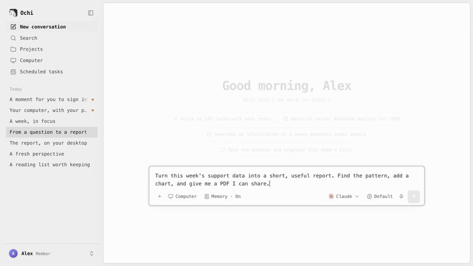

<details>
<summary>查看收起后的紧凑过程展示</summary>

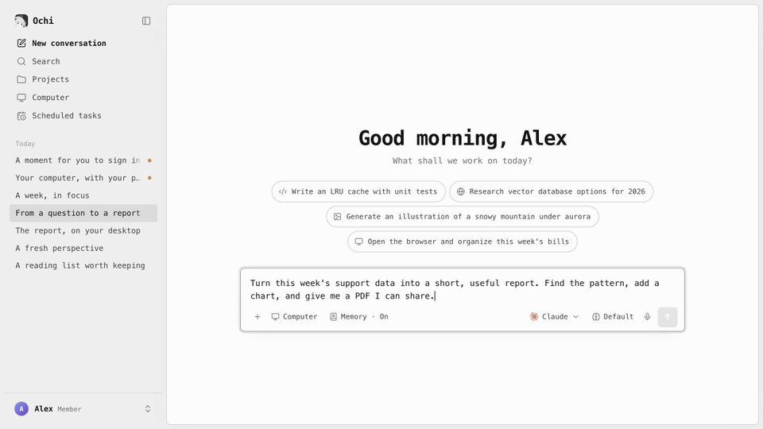

</details>

## 覆盖整个任务

| 能力 | 可以做什么 |
| --- | --- |
| **自主选择模型** | 接入模型 Provider，选择模型及其支持的思考程度，新对话保留个人首选。管理员统一管理可用模型、顺序和默认项。 |
| **研究与执行** | 搜索网页、读取来源、执行命令、处理文件，按发生顺序查看思考、进度和工具结果。可配置外部搜索服务。 |
| **云端持续运行** | Agent、工具和工作环境都在云端，关闭网页、退出 App 后任务仍会继续。使用者无需配置本地开发环境，也不用让个人电脑保持开机。 |
| **文件与交付** | 向 Web 输入框拖入文件或粘贴图片；预览图片、PDF 和 HTML，使用支持的模型生图，把需要交付的结果明确发布为可下载文件。单文件传输默认上限 1 GiB，可配置，且与模型输入预算分开。 |
| **项目与定时任务** | 用项目指令组织相关对话，或安排稍后执行的任务。 |
| **有明确边界的记忆** | 跨对话保留有用的事实和偏好，也能在新对话开始前关闭记忆。选择对整段对话固定，聊天记录和 Computer 行为照常保留。 |
| **Skills 与 MCP 插件** | 管理员把指令和集成组合成插件，用户选择启用可选插件；管理员要求的默认项保持开启。发现和调用都受同一套插件策略及 Computer 权限约束。 |
| **真正的 Linux 电脑** | 打开持久化桌面、浏览器和应用，观看 Agent 执行，也能手动接管。普通计算拥有独立环境，共享桌面则明确排队。 |
| **自己的部署** | 在后台管理模型、用户、工作区、诊断、应用更新和客户端下载入口。Web、iOS、Android 均支持简体中文、繁体中文和英文。 |

## Web、iOS 和 Android

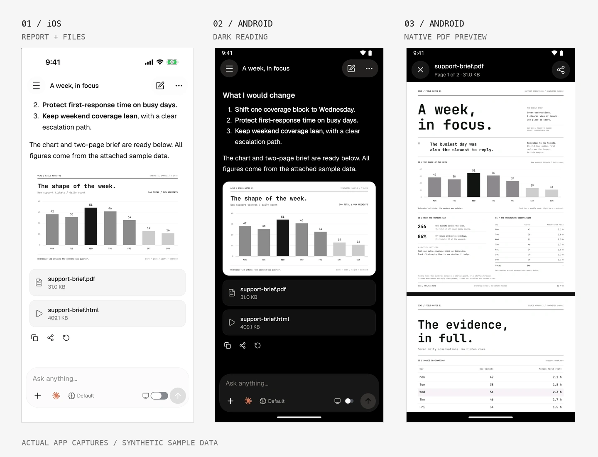

iOS 和 Android 使用 React Native 实现对话、输入框、Markdown、公式及原生文件
预览，与 Web 共享后端、聊天记录和实时运行状态。Computer、隔离 HTML 预览及
管理界面按需使用专门的 Web 页面。

<details>
<summary>查看 iOS 图片预览交互</summary>

从对话打开图片，向下拖动全屏预览，回到原来的位置。

<p align="center">
  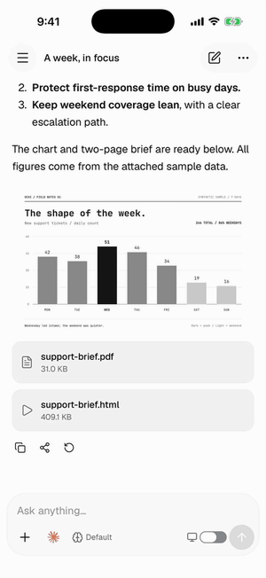
</p>

</details>

支持亮色和暗色外观，切换模型时保留草稿，在对话和成果之间切换。原生客户端可
连接自己的 HTTP 或 HTTPS 后端。管理员可上传 Android APK，客户端发现更新、
下载后交给 Android 系统安装器处理；iOS 下载入口打开配置的 TestFlight 或
App Store 链接。

## 可以逐层查看的工具链

展开处理过程，查看命令、输入、输出以及文件交付步骤。相关调用保持分组，
具体结果再展开一层即可查看，最终回复和交付文件也有清晰的位置。

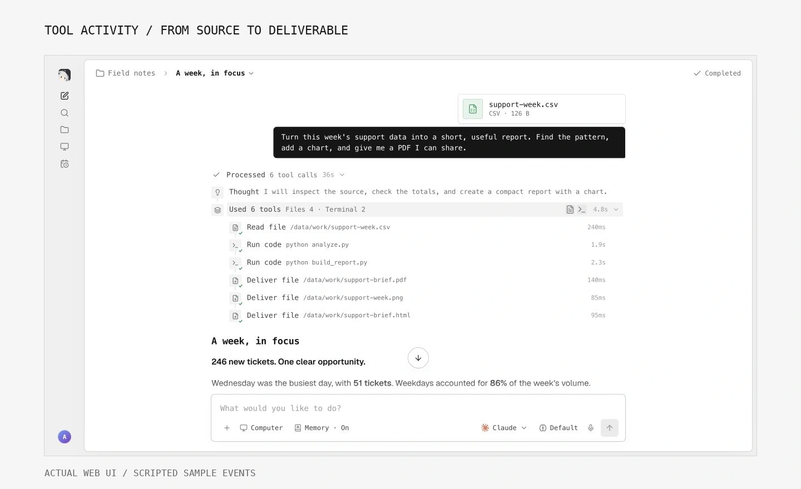

<details>
<summary>查看工具链展开动图</summary>

展开处理过程，查看两次命令的结果，再打开交付的 HTML 报告。

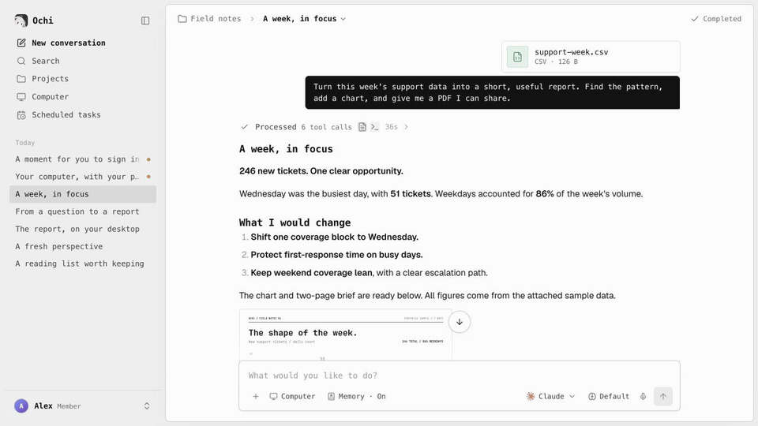

</details>

## Ochi 如何工作

Ochi 明确区分执行、上下文、记忆和资源调度的职责。下面四张图对应当前实现；
更完整的契约与边界见[架构文档](docs/architecture.md)。

### 服务端持有的执行循环

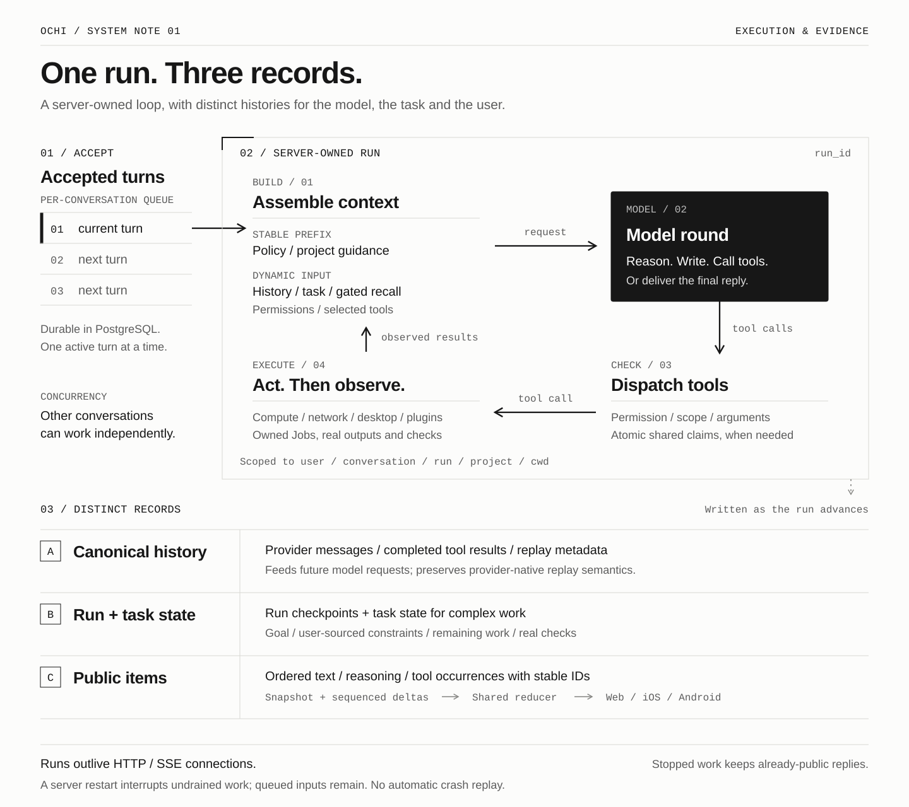

- **每段对话有自己的输入队列。** 接受的请求先持久化，再依次执行；不同对话
  可以并发工作。
- **下一轮模型接收实际观察到的结果。** 工具结果、未完成事项和验证证据共同
  支撑任务连续性；命令由拥有真实进程状态和日志的 Job 管理。
- **模型历史和用户看到的内容各有记录。** Canonical provider/tool history
  用于后续模型请求；有序公开条目保留文字、思考和工具活动，通过快照和带序号
  的增量驱动 Web、原生端共享的状态归并。终止运行后，已公开的回复仍然可见。

运行由服务端持有，独立于页面或流连接的生命周期。

### 围绕任务组装上下文

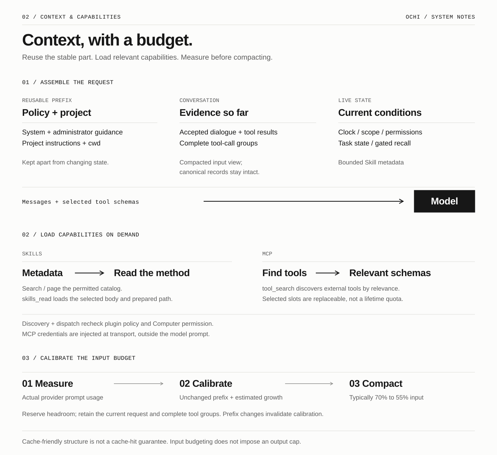

- **稳定指令放在前面。** 可复用策略和工具定义，与变化中的任务状态、环境、
  权限、相关记忆分开组织，为支持缓存的 Provider 保留可复用前缀。
- **先发现能力，再加载细节。** Agent 查找 Skill 或 MCP 工具后，按需取得
  选中的指令或 schema。私有控制运行时在传输层为 MCP 提供凭据。
- **以用量校准上下文预算。** Provider 的 prompt usage 校准已观察到的前缀，
  之后追加的内容仍按估算计入。压缩总结较早的证据，保留 canonical transcript。
  任务约束和待办另有明确的状态记录。

### 有用、可追溯的记忆

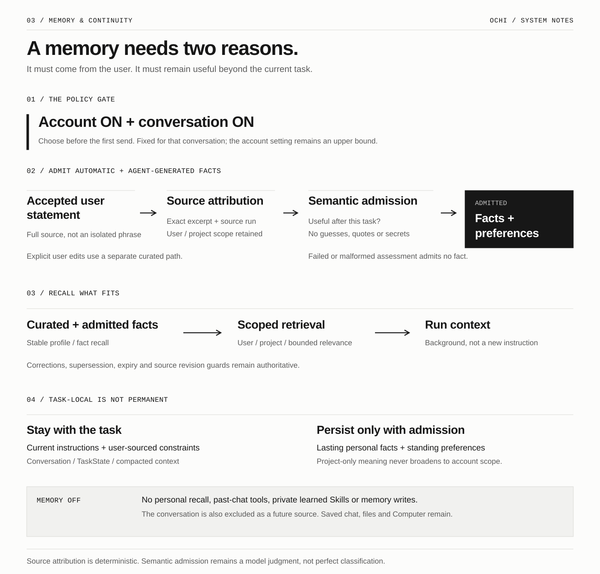

- **临时指令跟随任务。** 一句「用英文回答」会与长期语言偏好分别判断。
- **自动提取和 Agent 保存的记忆经过独立准入。** 来源归属和语义判断共同决定
  候选内容是否值得跨任务保留，并记录适用范围和出处，支持更正及替代。
- **关闭记忆时，同时关闭读取和写入。** 在第一条消息前选择：这段对话不接收
  个人记忆或跨会话检索，也不会成为未来记忆、学习型 Skills 的来源。普通聊天
  记录仍由用户保留和查看。

关闭记忆时，聊天记录、Computer 行为和管理员插件策略保持原有设置。
用户可以查看和管理已经保存的记忆。

### 独立计算，协调桌面

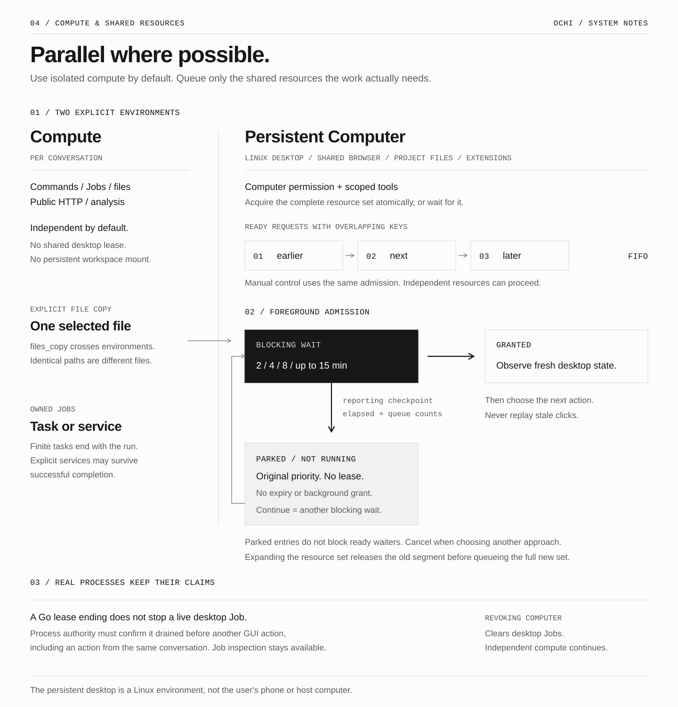

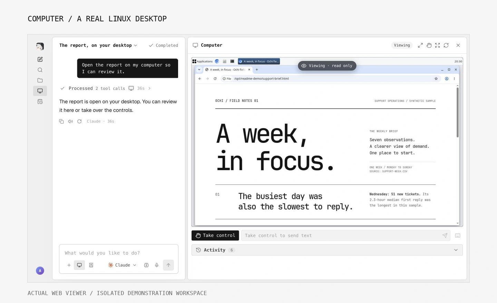

Agent 可以请求仅本轮或整段对话使用 Computer。任务需要你登录时，它可以暂停，
请你接管桌面；自行完成登录后，交还控制，再确认让它继续。

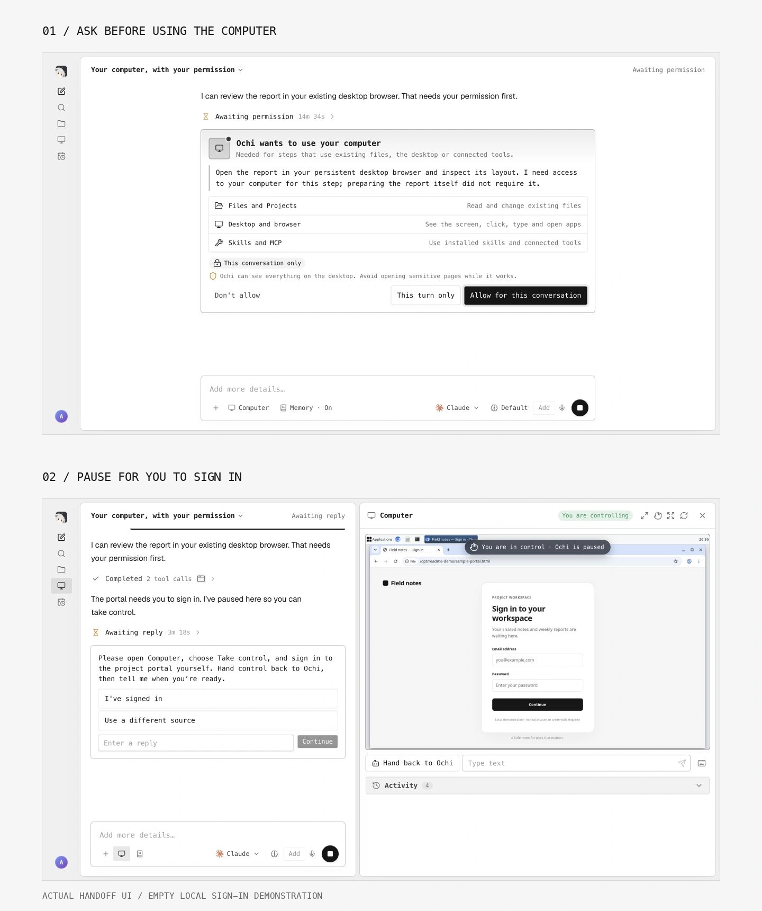

- **普通命令默认使用隔离计算环境。** 各段对话可以执行代码，无须占用共享
  桌面；访问持久化桌面文件需要明确指定环境，也能显式复制选中的文件。
- **冲突的共享操作按 ready FIFO 排队。** 桌面和项目资源整体申请；需要扩大
  资源集合时，先结束原来的占用，再等待完整的新集合。
- **排队通过前台阻塞工具完成。** 检查点报告已等时长和队列状态；暂停决定的
  请求保留优先级、不持有租约，也不阻挡已经就绪的任务。继续等待会发起新的
  阻塞调用，不会在后台突然获锁或重放已经过时的桌面操作。
- **真实 Job 决定占用。** 桌面进程存活期间持续占用相应资源，直到确认结束；
  Agent 获准使用桌面后，先取得新的观察，再决定下一步 GUI 操作。

Computer 运行在服务端的 Linux 容器中。

## 开始使用

需要 Docker Engine 和 Compose。macOS 可使用 Docker Desktop 或 OrbStack
提供引擎。

```sh
cp .env.example .env
```

在 `.env` 中填写 `POSTGRES_PASSWORD`，以及 `OCHI_USERS` 里初始管理员的
密码。模型 Provider 可以在这里配置，也可以登录后通过管理后台添加。

```sh
docker compose build
docker compose up -d db server
```

打开 [localhost:8090](http://127.0.0.1:8090)。默认只绑定本机回环地址，模型
密钥保留在服务端。`RUNNER=demo` 显式启用开发演示模式，不会在缺少 Provider
配置时自动启用。

部署已构建版本时，使用同一次 CI 构建的配套镜像引用，参见
[部署文档](docs/deployment.md)。运行栈由 PostgreSQL/pgvector、内嵌 Web
客户端的 Go 服务，以及 Docker 管理的计算和桌面环境组成。

## 了解项目

| 路径 | 职责 |
| --- | --- |
| [`server/`](server/) | Go API、Agent 执行、存储、内嵌生产 Web |
| [`web/`](web/) | React、TypeScript、Vite Web 客户端 |
| [`mobile/`](mobile/) | Expo/React Native 客户端及版本化原生工程 |
| [`shared/`](shared/) | 对话契约、投影和客户端状态管理 |
| [`workspace/`](workspace/) | Linux 工具桥、插件控制、浏览器和 XFCE 桌面 |
| [`db/`](db/) | 包含 pgvector 的 PostgreSQL 镜像 |
| [`docs/`](docs/) | 当前架构、设计、开发和运维文档 |

- [架构](docs/architecture.md)：执行归属、上下文、记忆、插件与资源边界。
- [设计](docs/design.md)：渲染、视觉语言和平台交互。
- [开发](docs/development.md)：环境、验证方式与仓库约定。
- [部署](docs/deployment.md)：配置、持久化与更新。
- [发包](docs/releasing.md)：iOS/Android 打包和签名。
- [AGENTS.md](AGENTS.md)：编码 Agent 的入口。

GitHub Actions 构建多架构镜像及 Web/服务端组合程序，由管理员在 Ochi 中明确
发起更新；代码 push 不会直接部署。滚动的 `edge` 预发布提供更新通道，无须
为每一次修改递增产品版本。
